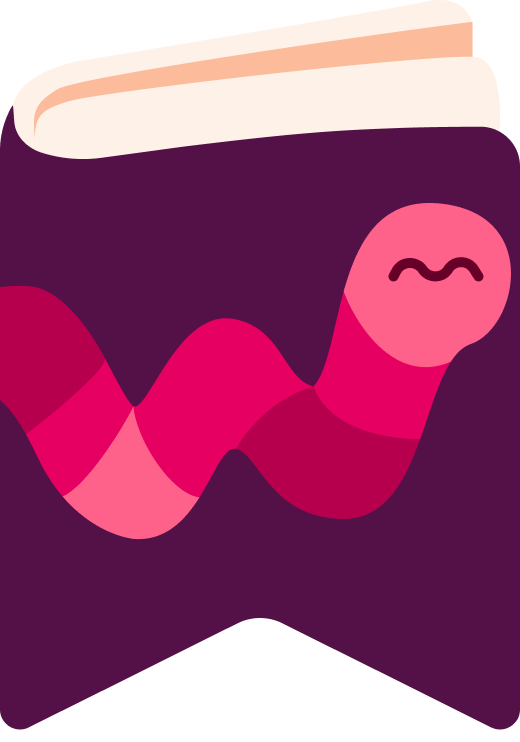

  

# Wiseworm

**Rediscover what you've read. Connect ideas. Keep knowledge close.**

You read, highlight, take notes... and eventually forget where you saved that life-changing quote. **Wiseworm** changes that. It brings your book highlights together into one intelligent Android app, turning scattered passages into a living web of knowledge.

**Version: 1.0.6**

## Screenshots

| Library (Dark) | Library (Light) | Map (Dark) |
| :---: | :---: | :---: |
|  |  |  |

| Map Detail (Light) | Review (Dark) | Edit Dialog (Dark) |
| :---: | :---: | :---: |
|  |  |  |

---

## Why You'll Fall in Love with Wiseworm

- **Unified Library:** Import your notes from Kindle and Google Play Books. All your best passages organized, searchable, and always at your fingertips.
- **Semantic Search:** Can't remember the exact phrase? No problem. Type an idea or a question (like *"How do institutions shape society?"*) and find passages by meaning, not just keywords.
- **Interactive Idea Map:** Explore thematic islands formed from your highlights. Follow lines connecting similar passages, discover connections across books, find singular highlights marked with halos, and use island anchors as starting points for exploration.
- **Effortless Spaced Review:** Revisit what you've read at the ideal pace. The app schedules intelligent reviews to help knowledge truly stick in your memory without the grind.
- **Habits & Growth:** Track your reading streak, review consistency, and intellectual diversity across topics.

The map updates automatically as your library grows. You can also reorganize it manually, while the app tries to preserve its familiar arrangement. An illustrated guide explains the map's lines, halos, anchors, and reorganization controls.

---

## Your Library, Your Rules

Your library is stored directly on your device. Semantic search and map analysis run locally. Optional cloud features include Google Drive integration and AI-generated island names.

- **Requirements:** Android 14.0 or later.
- **Languages:** English, Brazilian Portuguese, and Spanish.

---

## Download and Transform Your Reading

Breathe new life into your highlights. Install Wiseworm, bring in your first book, and discover a whole new way to converse with the authors who inspire you.

---

  Copyright © 2026 <strong>Wiseworm</strong>. All rights reserved.

